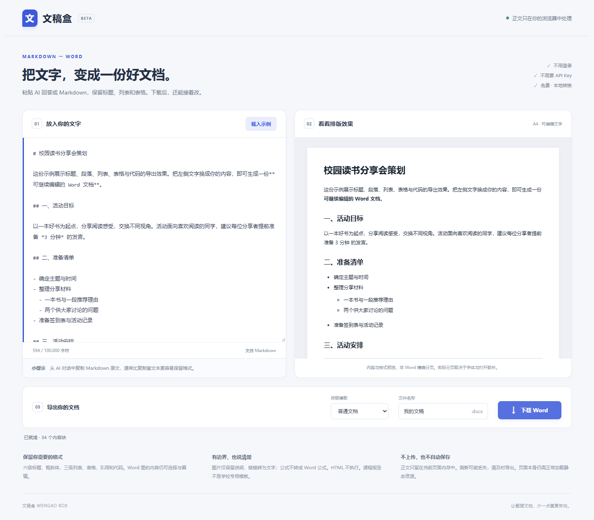

# 文稿盒 Wengao Box

**把 Markdown / AI 回答，变成可以继续编辑的 Word 文档。**

粘贴文字 → 看排版 → 下载 `.docx`。不用登录，不需要 API Key，正文不上传。

[English](README.en.md) · [发布指南](docs/DEPLOY.md) · [测试记录](docs/QA.md) · [输入示例](src/sample.md) · [直接查看导出的 Word](examples/普通文档示例.docx)



## 适合什么时候用

- 把 AI 回答整理成会议记录、活动方案、学习笔记。
- 把 Markdown 中的标题、列表、表格整理成可编辑的 Word。
- 不想为一份简单文档，反复手工调整字体和标题。

这不是 AI 内容生成器，不是必须安装的 Skill，也不核查内容是否真实。它只做一件事：**将你已有的文字转换成文档**。

## 30 秒试用

1. 打开网页，点击 **载入示例**。
2. 右侧出现《校园读书分享会策划》，包含标题、列表、表格与代码。
3. 选择 **普通文档** 或 **课程报告**，填写文件名。
4. 点击 **下载 Word**，用文字处理软件打开 `.docx`，选中正文直接修改。

没有在线网址？先按下面的命令本地运行。本仓库尚未绑定特定账号或网站，发布者部署后可在此补充演示地址。

### 本地启动

需要 Node.js 22.12+，推荐 Node.js 24。

```bash
npm ci
npm run dev
```

打开终端显示的本地地址。不能直接双击源码中的 `index.html`；源码需要构建或开发服务器处理。

```bash
npm run build
npm run preview
```

`dist/` 是可部署到静态服务器的成品。资源地址使用相对路径，适用于 GitHub Pages 的仓库子路径。

## 支持什么

| 内容 | 转换效果 |
| --- | --- |
| 一级至六级标题 | 原生 Word 标题样式，保留级别 |
| 普通段落、粗体、斜体、删除线 | 可选择、可编辑的文字 |
| 有序与无序列表 | 原生编号，最多 3 层，可从非 1 数字开始 |
| Markdown 管道表格 | 原生表格，第一行作表头，不支持合并单元格 |
| 行内代码、围栏代码块 | 等宽文本；不执行代码 |
| 引用与分隔线 | 引用缩进与段落边框 |
| 两套中文模板 | 普通文档 / 课程报告，均为 A4 |

课程报告仅是通用排版预设，**不代表任何学校的格式标准**。使用本机字体，不嵌入字体；普通文档优先微软雅黑，课程报告正文优先宋体。

## 隐私与边界

- 文稿只在当前页面内存中处理，不上传、不发给模型、不存入 localStorage。
- **不会自动保存。** 刷新或关闭可能丢失文稿；未导出时尝试触发浏览器离开提醒，但浏览器不保证所有关闭场景都弹窗。
- 页面加载会产生正常静态资源请求，托管平台可能记录访问日志。运行依赖打包在本站，不使用 CDN、在线字体或统计服务。
- 已加载页面可以断网继续输入和导出；这不等于断网后可以首次打开或刷新页面。
- 图片不下载、不嵌入，只保留说明及地址。链接变为名称和地址文本。HTML 按文字保留，不执行。
- LaTeX 数学公式只作为文字，不转为 Word 公式。脚注、复杂图表、富文本剪贴板样式、复杂 Markdown 扩展不承诺支持。
- Markdown 字符实体（如 `&amp;`）按源文字保留。软换行保留为换行，不合并为一行。
- 预览展示内容与样式，**不是 Word 的精确分页**。长 URL、长代码、宽表格、emoji 和本机缺失字体请在导出后检查。
- 最多 100,000 个字符（按 JavaScript UTF-16 长度计）、500 个块级元素；表格最多 30 列、200 行（含表头）。嵌套也有限制。超限报错，不截断正文。表格某行列数多于表头时拒绝转换，避免静默丢失多出的单元格。
- 生成文件不包含宏或远程图片关系，但工具不能替你核查正文内容与文本地址是否可信。

## 开发与验证

```bash
npm test
npm run build
npm audit
```

浏览器测试默认使用本机 Edge：

```bash
npm run test:browser
```

若没有 Edge，安装 Playwright Chromium 后运行：

```bash
npx playwright install chromium
# macOS / Linux
PW_CHANNEL=chromium npm run test:browser
# Windows PowerShell
$env:PW_CHANNEL='chromium'; npm run test:browser
```

测试覆盖解析边界、危险输入、DOCX ZIP/XML、标题、表格、列表、示例替换确认、下载、移动宽度、断网导出。测试细节与未验证环境见 [QA 记录](docs/QA.md)。**工作流文件不等于远程 CI 已成功。**

代码结构：`parser.js` 生成共享文档结构，`preview.js` 用安全 DOM 构建预览，`exporter.js` 生成 DOCX，`templates.js` 集中管理排版。UI 不负责转换规则。

## 贡献与许可

欢迎提交脱敏后可复现的输入、预期效果和实际截图。请勿提交真实学生信息、公司资料、密码或 API Key。

项目采用 MIT；第三方依赖许可见 [完整声明](public/third-party-licenses.txt)。如果工具确实帮你省了时间，欢迎 Star 或分享给需要的人。不承诺评分、用户数或 Star 数。
